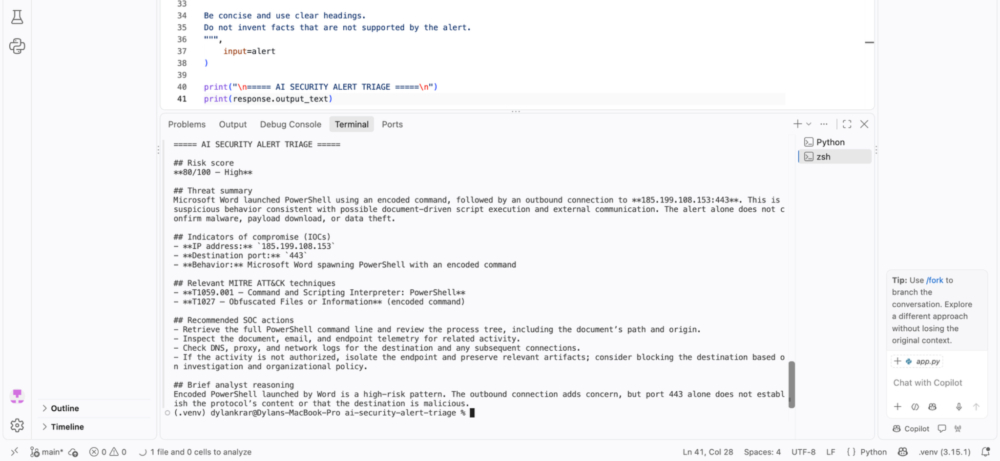
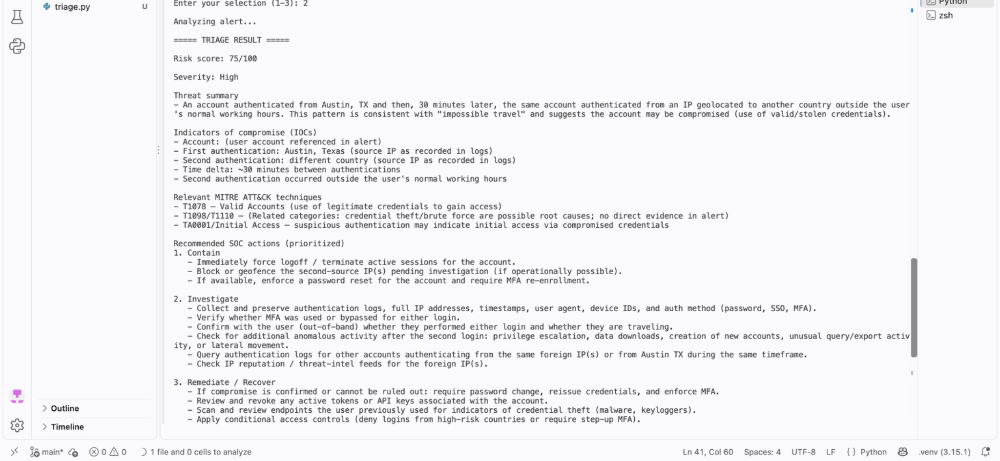
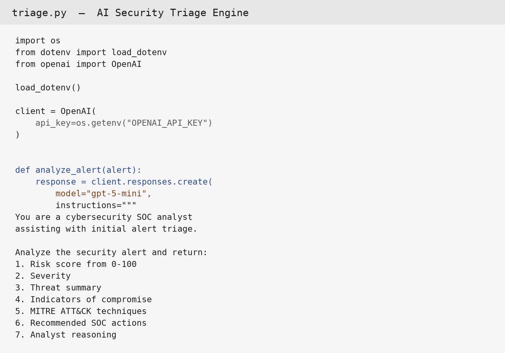

# AI Security Alert Triage

An AI-assisted cybersecurity tool that analyzes security alerts and provides initial SOC triage, risk assessment, indicators of compromise, MITRE ATT&CK techniques, and recommended response actions.

## Overview

Security operations teams receive large volumes of alerts that require rapid investigation and prioritization.

This project explores how generative AI can assist analysts during the initial triage process by transforming a security alert into a concise, analyst-oriented assessment.

The application is built in Python and integrates with the OpenAI API.

## How It Works

```text
Security Alert
      ↓
Python Application
      ↓
AI Security Analysis
      ↓
Risk & Severity Assessment
      ↓
IOC Identification
      ↓
MITRE ATT&CK Mapping
      ↓
Recommended SOC Actions
```

## Capabilities

The tool can analyze several types of security alerts, including:

* Suspicious PowerShell activity
* Suspicious authentication activity
* Potential malware execution

For each alert, the AI provides:

* Risk score (0–100)
* Severity classification
* Threat summary
* Indicators of compromise (IOCs)
* Relevant MITRE ATT&CK techniques
* Recommended SOC investigation and response actions
* Analyst reasoning

## Example
## Screenshots

### AI Security Alert Triage

The tool analyzes a suspicious PowerShell alert and provides an initial risk assessment, indicators, MITRE ATT&CK techniques, and recommended SOC actions.



### Suspicious Authentication Triage

The tool can also analyze authentication anomalies and identify potential security concerns for further investigation.



### AI Triage Engine

The core Python module connects the application to the OpenAI API and performs the security alert analysis.


### Input

```text
Microsoft Word launched PowerShell with an encoded command.
The PowerShell process connected to 185.199.108.153 over port 443.
```

### Example AI Triage

```text
Risk Score: 78/100
Severity: High

Threat Summary:
Microsoft Word spawned PowerShell with an encoded command and
established an outbound connection to 185.199.108.153.

Indicators:
- 185.199.108.153
- PowerShell
- Encoded command

MITRE ATT&CK:
- T1059.001 — PowerShell
- T1027 — Obfuscated Files or Information

Recommended SOC Actions:
- Investigate the PowerShell command
- Review the originating document
- Search for additional connections to the identified IP
- Investigate the affected endpoint
```

## Technologies

* Python
* OpenAI API
* OpenAI Responses API
* python-dotenv
* Git / GitHub
* MITRE ATT&CK

## Project Structure

```text
ai-security-alert-triage/
├── README.md
├── app.py
├── triage.py
├── requirements.txt
├── .gitignore
```

## Security Considerations

API credentials are stored locally using environment variables and are intentionally excluded from version control through `.gitignore`.

The application is designed as an AI-assisted triage prototype. AI-generated findings should be validated by a security analyst before being used for production security decisions.

## Running the Project

### 1. Clone the repository

```bash
git clone https://github.com/dhue/ai-security-alert-triage.git
cd ai-security-alert-triage
```

### 2. Create and activate a virtual environment

```bash
python -m venv .venv
source .venv/bin/activate
```

### 3. Install dependencies

```bash
pip install -r requirements.txt
```

### 4. Configure the API key

Create a `.env` file:

```text
OPENAI_API_KEY=your_api_key_here
```

Never commit the `.env` file to GitHub.

### 5. Run the application

```bash
python app.py
```

Select an alert scenario and the application will send it to the AI analysis engine and display the resulting security triage.

## Project Goals

This project was developed to explore the intersection of:

* Cybersecurity operations
* AI-assisted security analysis
* SOC alert triage
* Threat detection
* MITRE ATT&CK
* Security automation

The goal is not to replace a security analyst, but to demonstrate how AI can assist analysts by accelerating the initial assessment of security alerts.

## Future Improvements

Potential future enhancements include:

* Web-based user interface
* Structured JSON output
* Additional alert types
* Automated IOC enrichment
* SIEM integration
* Alert prioritization and filtering
* Analyst feedback and validation workflows

